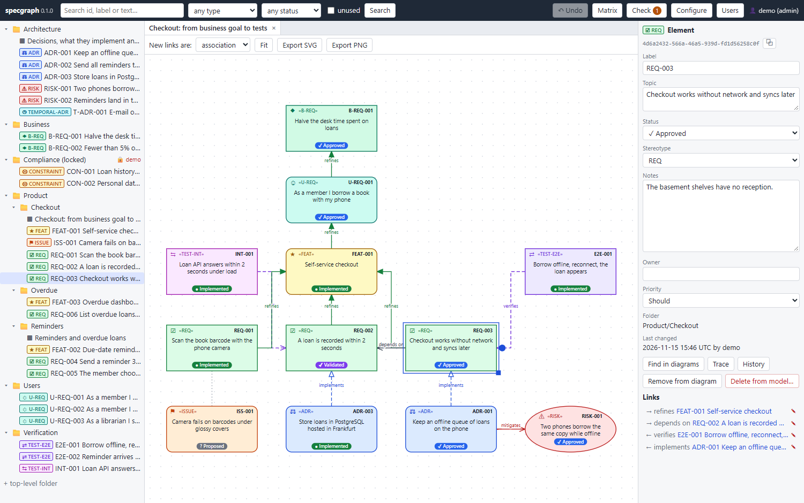
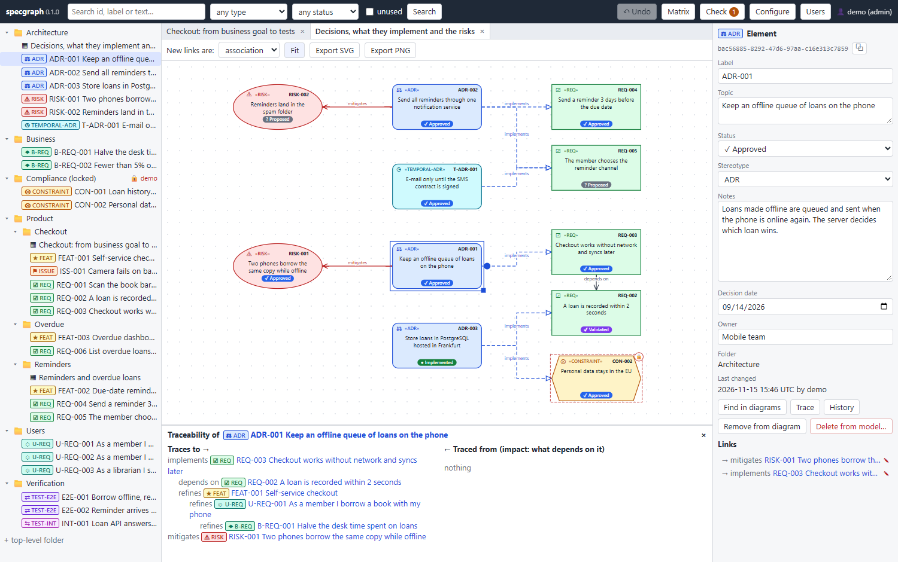
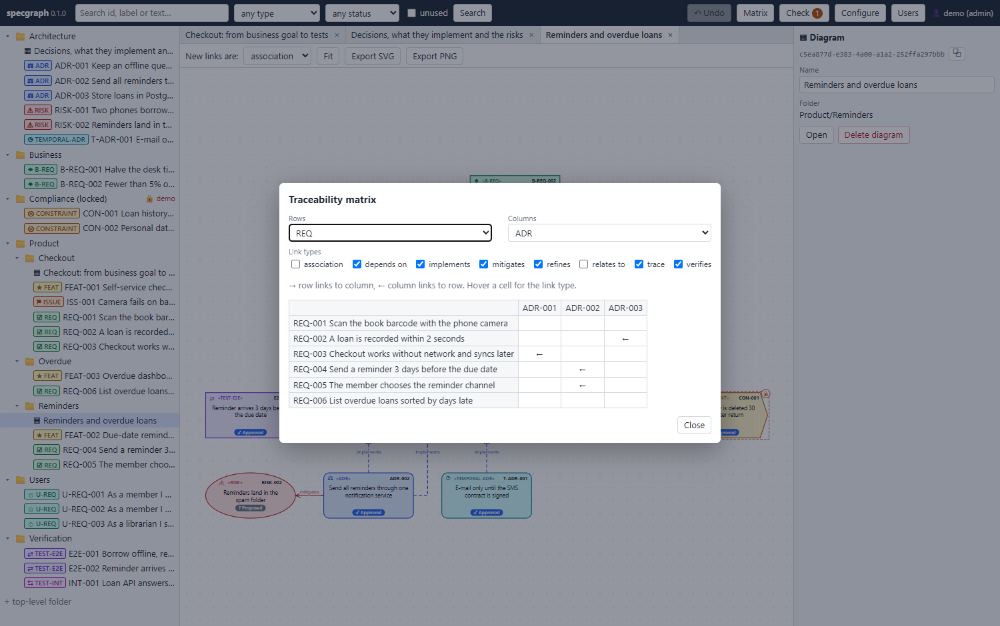

# specgraph

A graph of specifications: elements of any type you define (requirements, decisions,
rules, risks, tests, ideas, …) and typed links between them. The whole model is
**one JSON file in your Git repository** (`specmodel.json`). People edit it in a
graphical editor in the browser; AI agents read the file directly and change it
through a command.

- Runs with **Python only** (3.8+, tested on 3.13; standard library). No pip packages, no Node, no build step, no hosted server, no database: the editor is a page served by a small program on your own machine.
- Uses two programs you already have with Git: `git` and `ssh-keygen`.
- No third-party code is bundled. Test-only extras: `pytest`, and optionally `playwright`.
- MIT licensed.

**Status: version 0.1.0, an early release.** It works for the author's own use, and the file format
and commands may still change. It has been run on Windows (Git Bash) with Python 3.13 only; Linux,
macOS and older Python versions are expected to work but have not been checked. The signing and
integrity checks have not been reviewed by anyone independent: read ADR-003 in `docs/ADRS.md` for
what they do and do not prove before you rely on them.

## What it looks like

The pictures show the example model in this repository (`specmodel.example.json`): a small
library app, from the business goal down to the tests. To open it yourself, see
[Example model](#example-model).

**Diagrams.** Folder tree on the left, diagram in the middle, properties of the selected
element on the right. Each type has its own colour, shape and fields; the status is shown
on the element. A link belongs to the model, so it appears on every diagram that shows both ends.



**Traceability.** *Trace* on an element lists what it leads to and what depends on it, over
the whole model and not only the open diagram. Here: a decision, the requirement it
implements, and up to the business goal.



**Matrix.** Any two types against each other, for the link types you tick. The empty rows
are requirements that no decision implements yet.



## AI-assisted development

This project was developed with the help of AI models (Claude, by Anthropic), which
wrote much of the code and documentation. The maintainer directs and reviews the work
but cannot guarantee that he has understood or verified every line. The software is
provided "as is", without warranty of any kind (see `LICENSE`). Review it before you
rely on it, especially the signing and integrity checks (ADR-003 in `docs/ADRS.md`).

The AI model's own account of its part and of what it checked is in `AI-Disclaimer.md`.

## Setup (once per person, about two minutes)

Run the commands from the folder that contains `sg.py` (the root of this repository). They work
in Windows cmd, PowerShell and Linux/macOS shells unless marked; do not paste the `#` comments into cmd.

1. **Python 3.13** (3.8+ works). If your default Python is another version or things fail,
   make a project-local environment (the tool itself needs no packages):

   ```
   pip install uv
   python -m uv python install 3.13
   python -m uv venv --python 3.13 .venv
   ```

   Activate it in **every new terminal**: Windows `.venv\Scripts\activate`,
   Linux/macOS `source .venv/bin/activate`. Check `python --version` prints 3.13.
   If `uv` is "not recognized", keep writing `python -m uv …`; no PATH fix needed.
2. **An SSH key, loaded in `ssh-agent`.** Every change is signed with your SSH key, and the
   administrator registers its public half under *Users*. Use the key you already have, or
   create one with a passphrase: `ssh-keygen -t ed25519`. There is nothing to configure and no
   path to point to: the tool asks `ssh-agent` which keys are loaded and uses the one registered
   in the model. It never reads a private key file and never asks for a passphrase.

   Load the key once per terminal session (the full routine is under *Daily use → Starting the
   editor*). On Windows use **Git Bash** (it ships with Git):

   ```
   eval "$(ssh-agent -s)"
   ssh-add
   ```

   `ssh-add` loads `~/.ssh/id_ed25519`; for another key, give its path. Check with `ssh-add -l`.
   (On Linux/macOS the agent usually runs already. Windows cmd/PowerShell also work if the
   *OpenSSH Authentication Agent* service is running.)

   - **No key in the agent, no editor.** `serve` signs a short challenge through the agent
     before it opens and refuses to start if that fails, for example after `ssh-add -D`.
     Every `init`, `apply` and save also signs through the agent.
   - **Protect the key with a passphrase.** A key without one can be used by anyone who can read
     the file. The passphrase is asked only by `ssh-add`.
   - **Exactly one key must be loaded.** With none, or with two or more, the tool refuses to run and
     tells you how many it found. It never picks one for you. Unload all with `ssh-add -D`, then load
     only the key you work with: `ssh-add <path to your key>`.
   - On Windows `ssh-keygen` and `ssh-add` ship with Git for Windows. If not found, set
     `SPECGRAPH_SSH_KEYGEN` / `SPECGRAPH_SSH_ADD` to their full paths
     (usually under `C:\Program Files\Git\usr\bin\`).
3. **Specification branch.** A new repository needs at least one commit first.

   ```
   git switch docs/specifications            # branch exists
   git switch -c docs/specifications         # branch does not exist yet
   ```

4. **Start the model** (first person only; you become administrator):

   ```
   python sg.py init
   python sg.py install-hooks
   git add specmodel.json .gitattributes
   git commit -m "Start the model"
   ```

   - Your administrator name is your `git config user.name` with spaces turned into dots
     ("Ann Smith" → `Ann.Smith`). Choose another with `init --user NAME`.
   - `whoami` and `serve` fail with "cannot read specmodel.json" until `init` has run.
   - The repository's `.gitattributes` has `* text=auto eol=lf`, so every text file is
     LF on Windows and Linux alike and no "LF will be replaced by CRLF" warning appears.
     Keep that line when you copy the tool into another repository; `install-hooks`
     only adds the `specmodel.json` rule. If a repository already shows the warning,
     add the line, then run `git add --renormalize .` and commit.
   - `install-hooks` stores the path of the Python that ran it: run it with the
     environment active, and again with `--force` if `.venv` is recreated.
5. **Everyone else:** `git pull`, activate Python, run `install-hooks`, then send the
   administrator your **public** key (`.pub` file, never the private one). The
   administrator adds you under *Users*. `python sg.py whoami` shows
   whether you are recognised.

### Setup problems

| You see | Cause and fix |
|---|---|
| `can't open file …\sg.py` | You are not in the folder that contains `sg.py`: `cd` there first |
| `invalid reference: docs/specifications` | Branch does not exist: `git switch -c docs/specifications` |
| `no key is loaded in ssh-agent` / `cannot reach ssh-agent` | Start the agent and run `ssh-add` (step 2) |
| `cannot read …specmodel.json` | No model yet: run `init` |
| `cannot prove that you hold the private key` / `signing failed` | The key is not loaded in `ssh-agent`: `ssh-add` it (step 2) |
| `'uv' is not recognized` | Use `python -m uv …` |
| `'source' is not recognized` (cmd) | Windows activate is `.venv\Scripts\activate` |

## Daily use

### Starting the editor

The editor opens only when your SSH key is loaded in `ssh-agent`. Each time you start work:

1. **Open Git Bash** in the repository folder (Windows: right-click the folder → *Open Git Bash here*).
   Use the **same terminal for steps 2 to 5**: the agent is found through variables of that terminal.
2. **Activate Python** (if you use the project `.venv`): `source .venv/Scripts/activate`
   (Linux/macOS: `source .venv/bin/activate`).
3. **Start an agent**, unless one is already running (`ssh-add -l` answers "Could not open a
   connection" when none is):

   ```
   eval "$(ssh-agent -s)"
   ```

4. **Load your key** and type its passphrase when `ssh-add` asks:

   ```
   ssh-add
   ```

   For a key that is not `~/.ssh/id_ed25519`, give its path: `ssh-add ~/.ssh/my_key`.
5. **Check, then start:**

   ```
   ssh-add -l
   python sg.py serve
   ```

   `ssh-add -l` must list your key. Open exactly the link that `serve` prints.

If `serve` stops with `no key is loaded in ssh-agent` or `cannot reach ssh-agent`, repeat steps 3
and 4 in that terminal. A new terminal window has no agent of its own and needs both steps again
(a second Git Bash window does not share the first window's agent).

To lock the tool again: `ssh-add -D` (unloads all keys) or `ssh-agent -k` (stops this agent).
The editor already open keeps running until you stop it, but its next save needs the key again.

Windows without Git Bash: start the *OpenSSH Authentication Agent* service once (Services → Startup
type Automatic), then run `ssh-add` in cmd or PowerShell. That agent is shared by all windows and
survives restarts of the terminal. This path is not covered by the tests.

### Using the editor

Your browser opens the editor (it only listens on your own machine).

- **Left:** folder tree. Right-click a folder for *New REQ / ADR / …*, *New diagram*, *Lock*.
  Drag items between folders. Double-click a diagram to open it.
- **Middle:** diagrams. Drag elements in from the tree, or right-click the background to create one there.
  Drag to move, corner handle to resize, blue dot to draw a link to another element.
  Double-click a link to add a bend (user-defined routing). *Delete* key removes from the diagram only.
- **Undo**: the *Undo* button or Ctrl+Z takes back your last changes in this editor session
  (20 steps; `serve --undo N` or `SPECGRAPH_UNDO=N` to change, 0 = off). The list is emptied when
  the editor stops or the file is changed by something else (a command, `git pull`).
- **Deleting from the model** always asks first. Deleted elements are written to
  `specmodel.deleted.jsonl` with their last commit; commit that file with the model.
- Every element shows who last changed it and when; the ⧉ button next to an id copies it.
- The tool version is shown next to the name in the top bar (`python sg.py --version`).
- **Right:** properties of what is selected. Edits apply when you leave the field.
- **Search** (top): id or the start of an id, label, or any text. Each result lists its diagrams;
  **double-click a diagram** to open it with the element centred and selected.
- **Locks:** *Lock* on a folder says "I am working here". While it is set, nobody else changes the
  folder, its sub-folders or anything in them, and nobody else links to its elements; you still can.
  Others can view it and place its elements on their diagrams. It is meant to be temporary: when you
  are done, *Unlock*. **Lock, then commit and push**, and tell people to pull: the lock only protects
  once they have it. If the person is gone, anyone can unlock, after a confirmation that names the owner,
  the reason and the date; the unlock is recorded in the history.
- **Check:** validation problems, the integrity state and merge conflicts to settle.
- **Configure:** stereotypes, statuses, link types, custom fields, coverage rules. **Users:** people and keys.

Then commit and push as usual. Git history is the history of the model; *History* on an
element shows it in words ("status Proposed → Validated, by bob, 2026-11-13").

## Branch workflow

- The model is edited on `docs/specifications` (change it under `settings.branch`, op `settings.put`).
  On another branch the editor is read-only and tells you which branch to switch to.
- Several people work in parallel and `git pull`. The installed merge driver merges per item and
  per field, so most pulls just work. If two people changed the same field, git reports a conflict,
  the file stays valid, and the editor shows both values under **Check** — pick one, then
  `git add specmodel.json && git commit`.
- If a merge was done without the driver and the file has conflict markers: `python sg.py resolve`.
- Never edit `specmodel.json` by hand. If it happens, the tool goes read-only and offers
  *Adopt* (take responsibility for the change under your name) or restore it with `git checkout -- specmodel.json`.

## Checks (no CI server)

| When | What runs |
|---|---|
| every change in the tool | validation of the change, lock rules, identity, signed stamp |
| `git commit` (hook) | `sg.py check --staged`: valid model, intact stamp, known signer, locks respected, right branch |
| `git push` (hook) | `sg.py audit --quiet` over the branch history |
| any time | `sg.py audit` reports every commit that broke a rule, even if hooks were skipped |

## For AI agents

Read `specmodel.json` directly (format: `docs/FORMAT.md`). Change it only with
`sg.py apply` (see `docs/AGENTS.md`).

## Example model

`specmodel.example.json` is a complete model to look at: 26 elements of 11 types (B-REQ, U-REQ,
FEAT, REQ, ADR, TEMPORAL-ADR, CONSTRAINT, RISK, ISSUE, TEST-E2E, TEST-INT), 26 links, three
diagrams, one locked folder, an added link type ("verifies") and one coverage rule
("an approved requirement is verified by a test", which REQ-001 fails on purpose; see *Check*).

**Read it** without any key. Open the file in a text editor, or query it:

```
python sg.py --file specmodel.example.json search offline
python sg.py --file specmodel.example.json trace ADR-001
python sg.py --file specmodel.example.json matrix REQ ADR
python sg.py --file specmodel.example.json validate
```

**Play with it** in the editor. The stored file is signed by a throwaway key, and the editor
only opens a model for a registered user, so it will not open that file for you. Build your
own copy instead: the same content in a new folder, with you as its administrator. Load your
SSH key first (Setup, step 2).

```
python sample/build_example.py /tmp/example
python sg.py --file /tmp/example/specmodel.json serve
```

Use any empty folder outside this repository (Windows cmd: `%TEMP%\example`). Nothing you do
there touches the repository. `sample/build_sample.py` builds a second, smaller demo the same way
(it is the one the browser tests use).

The stored file and the pictures above come from `sample/build_example.py`; a test checks that
the file still matches the script.

## Tests

```
python -m pytest tests            # needs pytest; browser tests also need playwright + Chrome, else they skip
                                  # (Windows: set CHROME to the full path of chrome.exe)
```

The tests use your real `ssh-keygen` and `ssh-agent` (both ship with Git). They start a private agent
of their own, load three throwaway keys into it and stop it afterwards; your own agent and keys are not touched.
Without them the signing tests are skipped.

## Safety notes

- The editor server binds to `127.0.0.1`, requires a random per-run token on every request,
  rejects foreign `Host` headers and serves three fixed files. It never executes model content.
- The tool never reads a private key or a passphrase: signing is done by `ssh-keygen` through `ssh-agent`.
- What the integrity mechanism does and does not prove: `docs/ADRS.md`, ADR-003.
- A security review of version 0.1.0, with its limits, is in `docs/SECURITY-REVIEW.md`.
- Found a security problem? Report it through the repository's *Security* tab on GitHub
  ("Report a vulnerability") if it is enabled, otherwise open an issue without the details
  and ask for a private contact.
